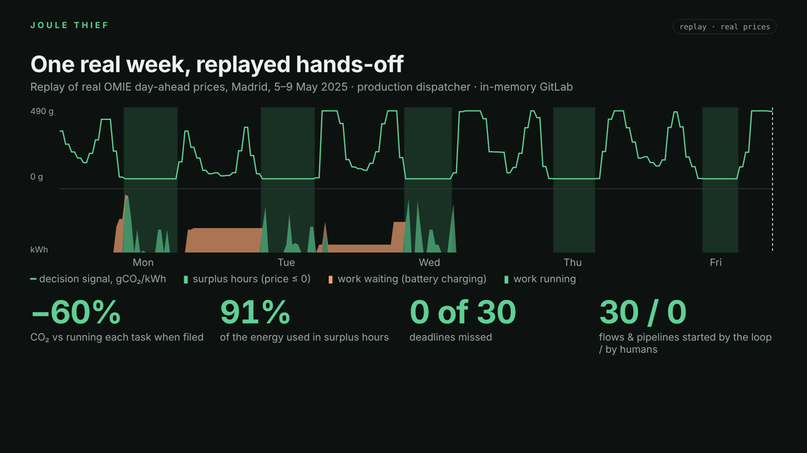

# Joule Thief

**Just-in-time Orchestration Using Leftover Energy** — hands-off agents that run the post-code
lifecycle on the energy the grid throws away. *The backlog is a battery.*



A [joule thief](https://en.wikipedia.org/wiki/Joule_thief) is a little circuit that squeezes the last
energy out of batteries everyone else considers dead. Joule Thief does the same with electricity
grids: GitLab Duo agents and pipelines do their deferrable work (dependency upgrades, test
matrices, scans, refactors) when clean power is in surplus, and critical work never waits.

Built for the GitLab Transcend Hackathon *Life After Code* — Path A, hands-off autonomy.

## Try it in 60 seconds, no accounts

```bash
pip install -r requirements-dev.txt
python -m joulethief.cli demo   # a real week of the Spanish grid, replayed hands-off (~1 s)
uvicorn app.main:app            # http://localhost:8000 → ▶ Replay the week
```

`joule demo` drives the production dispatcher against an in-memory GitLab: 30 issues filed over three
days, every one planned, held, released and shipped by the loop, with @grid explaining itself on the
issue. [Transcript](docs/results/hands_off_replay.md). A taste:

> **@grid · Madrid** — one more kWh here right now would be answered at about **347 gCO₂/kWh**. I'm holding
> this Surge Request until **Tue 08:10 UTC**, when I expect **11 gCO₂/kWh** (≈97% less). Deadline Tue 19:50 UTC is safe.
>
> **@grid · Madrid** — critical work never waits for me. Running now at **490 gCO₂/kWh**; waiting until
> Wed 07:50 UTC would have saved about **111.8 g**. Logged in the ledger as the price of urgency.

Result of that week: **−60 % CO₂** against running each task when filed, **91 %** of the energy used in
surplus hours (day-ahead price ≤ 0), **0** deadlines missed, 30 flows and pipelines started by nobody.

## What it does

- **Surge Requests.** A Duo flow triages every new issue: priority, kind of work, and whether it can wait.
- **@grid.** The electricity grid gets a seat at code review: it holds or releases work, with numbers.
- **Dispatcher.** Every 30 minutes, and within seconds of an issue becoming a Surge Request (GitLab
  webhook), an OR-Tools CP-SAT planner schedules the backlog on marginal and surplus signals (day-ahead
  prices, NESO, WattTime), under each issue's deadline, using Google's virtual-capacity-curve method.
  When the window opens it starts a Duo flow through the Flows API.
- **Carbon blame.** `git blame` for grams of CO₂: joules per request per source line, in every MR.
- **Carbon receipts.** Every image gets a Sigstore-signed in-toto attestation with energy, two carbon
  ledgers (attributional and consequential), water and the agents' own footprint (SCI for AI). No
  valid, within-budget receipt → no deploy.
- **Energy regressions are bugs.** The Cloud Run canary is promoted only if it isn't hungrier than production.
- **Governed.** The carbon budget is a compliance-centre external control; every pipeline accounts for itself.

## Results on real grid data

Same synthetic backlog, same deadlines, real grids, a receding-horizon dispatcher that never sees the future
([protocol](docs/METHODOLOGY.md#7-evaluation-protocol)):

| Grid | Hands-off vs run-now | Supervised vs run-now | Carbon dividend of autonomy | Deadlines missed (supervised / hands-off) |
|---|---:|---:|---:|---:|
| Great Britain, Sep–Oct 2026 | −24.9 % | −20.0 % | 4.9 % | 8 / 0 |
| Spain, spring 2025 | −31.6 % | −24.9 % | 6.8 % | 22 / 0 |
| Spain, summer 2025 | −28.8 % | −22.5 % | 6.3 % | 24 / 0 |

**Robust, not cherry-picked.** Over five independently seeded backlogs, hands-off never misses a deadline
and the dividend stays positive: 3–5 % (GB), 2–9 % (Spain, spring), 6–9 % (Spain, summer). With the
price→marginal knee anywhere from 20 to 80 €/MWh, hands-off still cuts Spanish emissions by 22–38 %
([robustness](docs/results/robustness.md)).

[Full results](docs/results/autonomy_dividend.md) · [Average vs marginal by region](docs/results/region_ledgers.md) ·
[Design](docs/DESIGN.md) · [Methodology](docs/METHODOLOGY.md) · [Data sources](docs/DATA_SOURCES.md) ·
[Setup at $0](docs/SETUP.md) · [Demo script & video](docs/DEMO.md) · [Carbon receipt spec](docs/RECEIPT.md) ·
[Submission text](docs/SUBMISSION.md)

## For judges: where to look

| Criterion | Evidence |
|---|---|
| **Technological implementation** | 5 custom Duo flows with triggers and token budgets ([`.gitlab/duo/flows/`](.gitlab/duo/flows)), 2 custom agents, an MCP server the agents call (6 tools at `/mcp`), flows started hands-off through the Flows API, a CP-SAT dispatcher, a 9-stage pipeline, 53 offline tests |
| **Design** | `joule demo` (no accounts), `joule bootstrap` (labels, flag, schedules and webhook in one idempotent command), a dashboard that replays a real week, @grid speaking on issues in numbers rather than slogans |
| **Potential impact** | An agent in every stage multiplies delivery's energy use (the GSF measures agentic coding at up to 1000× the tokens of chat). Joule Thief cuts the deferrable part's emissions by a quarter to nearly a third with zero missed deadlines, and removes the triage, scheduling, retry and release toil |
| **Quality of the idea** | Autonomy as a climate feature: hands-off work can follow the wind, supervised work cannot. The gap (the *carbon dividend of autonomy*) is measured, not claimed. Decisions use marginal signals, where most carbon tools use averages |
| **Most Environmentally Impactful** | SCI and SCI for AI per functional unit, two ledgers (attributional for reports, consequential for decisions), Sigstore-signed carbon receipts gating deploys, ranges everywhere: [Methodology](docs/METHODOLOGY.md) |
| **Most Stages Covered** | Plan · Create · Verify · Package · Secure · Release · Configure · Monitor · Govern: [Design §6](docs/DESIGN.md#6-the-nine-stages) |

## Quick start

```bash
python -m venv .venv && . .venv/bin/activate
pip install -r requirements-dev.txt
python -m pytest -q                         # 53 tests, offline
python -m joulethief.cli demo               # the hands-off loop end to end on a replayed week (~1 s)
python experiments/autonomy_dividend.py     # replays real GB and Spanish grids (~2 min)
python experiments/robustness.py            # backlog seeds × price knees (~15 min)
uvicorn app.main:app                        # dashboard + API + MCP server at /mcp
python -m joulethief.cli grid europe-north1 # live decision signal (needs internet)
python -m joulethief.cli bootstrap --dry-run # what the one-command GitLab setup would create
```

## Layout

```
joulethief/   signals · dispatch · carbon · receipts · blame · gitlab · loop · voice · mcp_server · cli
              replay (real grids as known at the time) · demo (the whole loop against an in-memory GitLab)
app/          Cloud Run control room (FastAPI) with eco-mode and the MCP server mounted at /mcp
.gitlab/duo/  custom flows (surge-intake, surge-worker, carbon-reviewer, retry-guard, release-captain),
              custom agents (@grid, carbon-accountant), MCP client config
.gitlab-ci.yml  plan · verify · test · secure · package · release · configure · monitor · govern
infra/        OpenTofu/Terraform for Google Cloud's free tier (keyless Workload Identity Federation)
data/         real grid snapshots and reference coefficients (see docs/DATA_SOURCES.md)
experiments/  the carbon dividend of autonomy and its robustness; average vs marginal per region
```

## License

MIT — see [LICENSE](LICENSE). Data files keep their own licences (docs/DATA_SOURCES.md).
